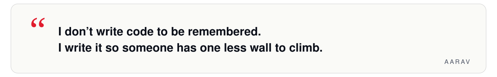

<picture>
  <source media="(prefers-color-scheme: dark)" srcset="assets/banner-dark.svg">
  
</picture>

<i>Some people leave footprints. I would rather leave doorways.</i>

<picture>
  <source media="(prefers-color-scheme: dark)" srcset="assets/divider-dark.svg">
  
</picture>

### &nbsp;A little about me

I was never good at standing still. Somewhere between a blank screen and a blinking cursor, I found the one place where restlessness turns into something useful.

I believe the best things we build are the ones that outlive our names: a door that opens for a student in a small town, a tool that quietly gives someone their evening back.

So I keep going. One line at a time. Toward a world a little kinder than the one I found.

### &nbsp;What I'm working toward

<picture>
  <source media="(prefers-color-scheme: dark)" srcset="assets/vision-dark.svg">
  
</picture>

 

<picture>
  <source media="(prefers-color-scheme: dark)" srcset="assets/quote-dark.svg">
  
</picture>

  

  <a href="https://horvans.com">
    <picture>
      <source media="(prefers-color-scheme: dark)" srcset="assets/mark-dark.svg">
      
    </picture>
  </a>
   
  Founder of <a href="https://horvans.com">Horvans</a> &nbsp;&middot;&nbsp; building, one line at a time

